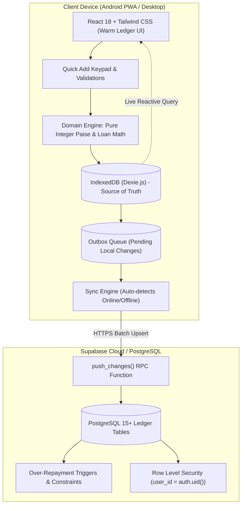

# डिजिटल हिशोब वही — Digital Hishob-Khata

<div align="center">


# **डिजिटल हिशोब वही**
### **Digital Hishob-Khata**
*सोपी, विश्वासू आणि आधुनिक कौटुंबिक हिशोब नोंदवही*  
*A production-grade, Marathi-first, mobile-first, offline-first digital accounting notebook designed for daily household expense and lending management.*

[](https://expensetracker-28i.pages.dev/)
[](tests/)
[](dist/)
[](tsconfig.json)
[](#)

</div>

---

## 📖 प्रकल्प परिचय (About The Project)

**डिजिटल हिशोब वही** हे केवळ एक साधे 'खर्च ट्रॅकर' नसून, वडिलांना (बाबांना) त्यांच्या दैनंदिन जीवनातील प्रत्येक रुपयाचा अचूक ताळेबंद कोणत्याही तांत्रिक अडचणींशिवाय ठेवता यावा यासाठी तयार केलेले एक डिजिटल साधन आहे.

हे अ‍ॅप पारंपरिक वहीप्रमाणे सोपे वाटते, परंतु वही जे गणित करू शकत नाही—जसे की उपलब्ध शिल्लक, कोणाकडे किती उधारी बाकी आहे, जुनी उधारी कशी वजा झाली, आणि मासिक हिशोब—ते अवघ्या ५ सेकंदात अचूकपणे पूर्ण करते.

### 🌐 थेट लाईव्ह अ‍ॅप (Live Application)
> **🔗 [https://expensetracker-28i.pages.dev/](https://expensetracker-28i.pages.dev/)**  
> *(Android/Chrome वर 'Add to Home screen' किंवा 'Install App' करून थेट फोनवर इन्स्टॉल करा)*

---

## 🌟 प्रमुख वैशिष्ट्ये (Core Capabilities)

### १. ५ प्रकारचे व्यवहार व शुद्ध हिशोब (The 5 Pure Financial Movement Types)
बहुतांश अ‍ॅप्स उधारीला 'खर्च' आणि उधारी परतीला 'उत्पन्न' मानून संपूर्ण हिशोब बिघडवतात. डिजिटल हिशोब वही खालील नियमांवर काम करते:

| व्यवहार प्रकार (Type) | मराठी नाव | शिल्लक परिणाम | आर्थिक वर्गीकरण |
| :--- | :--- | :--- | :--- |
| **Expense** | **खर्च** | खाते शिल्लक कमी होते | **खर्च (Expense)** |
| **Income** | **जमा** | खाते शिल्लक वाढते | **उत्पन्न (Income)** |
| **Lend** | **उधारी दिली** | खाते शिल्लक कमी होते | **काहीच नाही (येणे बाकी/Receivable तयार होते)** |
| **Repayment** | **परत मिळाले** | खाते शिल्लक वाढते | **काहीच नाही (उधारी बाकी कमी होते)** |
| **Transfer** | **हस्तांतर** | एका खात्यातून दुसऱ्या खात्यात पैसे फिरतात | **काहीच नाही (Net-Zero)** |
| **Write-off** | **माफ केले** | रोख शिलकीला धक्का लागत नाही | **उधारी निर्लेखित (Forgiven)** |

### २. शून्य-त्रुटी पूर्णांक पैसे गणित (Zero-Tolerance Integer Paise Arithmetic)
- सर्व पैशांचे व्यवहार अंतर्गत स्वरूपात **पूर्णांक पैशांमध्ये (`bigint`/integer paise)** साठवले जातात.
- **Derived Balances:** शिल्लक कधीही हार्डकोड किंवा थेट एडिट केली जात नाही; ती नेहमी सुरुवातीची शिल्लक आणि लेजर व्यवहारांवरून तत्काळ काढली जाते.
- **Section 7.3 Golden Test:** सेक्शन ७.३ मधील अनिवार्य गोल्डन टेस्ट चाचणीनुसार:
  - सुरुवातीची शिल्लक: ₹७०,००० (रोख ₹२०,०००, बँक ₹५०,०००)
  - २ नोव्हें: खर्च ₹२५० (रोख) → शिल्लक ₹६९,७५०
  - २ नोव्हें: रमेशला उधारी ₹१०,००० (बँक) → शिल्लक ₹५९,७५०, रमेश बाकी: ₹१०,०००
  - ३ नोव्हें: जमा उत्पन्न ₹३०,००० (बँक) → शिल्लक ₹८९,७५०
  - ४ नोव्हें: हस्तांतर ₹५,००० (बँक ➔ रोख) → शिल्लक ₹८९,७५० (Net Zero)
  - १० नोव्हें: रमेशकडून परत ₹२,००० (रोख) → शिल्लक ₹९१,७५०, रमेश बाकी: ₹८,०००
  - १५ नोव्हें: रमेशकडून परत ₹३,००० (बँक) → शिल्लक ₹९४,७५०, रमेश बाकी: ₹५,०००
  - २० नोव्हें: रमेशकडून परत ₹१,००० (रोख) → शिल्लक **₹९५,७५०**, रमेश बाकी: **₹४,०००**
  - **निव्वळ कॅश फ्लो (Net Cash Flow):** **+₹२५,७५०** (७०,००० + २५,७५० = ९५,७५० ✓)

### ३. उधारी व्यवस्थापन व हिशोब पत्रक (People & Udhaari Engine)
- **अनेक उधारी व हप्ते:** एकाच व्यक्तीला वेगवेगळ्या कारणांसाठी दिलेल्या उधारीची स्वतंत्र नोंद.
- **जुनी उधारी आधी वजा (Oldest-First Allocation):** व्यक्ती पैसे परत करते तेव्हा जुन्या उधारीनुसार आपोआप हिशोब जुळवला जातो.
- **Over-Repayment Prevention:** शिल्लक बाकीपेक्षा १ रुपयाही जास्त परत नोंदवण्यास मज्जाव.
- **उधारी माफी (Write-Off):** वसूल न होऊ शकणारी रक्कम येणे बाकीमधून माफ करण्याची अधिकृत सोय.
- **हिशोब पत्रक (Person Statement PDF):** व्यक्तीनिहाय देवाण-घेवाणीचा संपूर्ण हिशोब व्हॉट्सअ‍ॅपवर पाठवण्यासाठी एका क्लिकवर A4 PDF स्वरूपात तयार होतो.

### ४. "वार्म लेजर" डिझाइन (Warm Ledger Aesthetic)
- **कागदी वहीचा अनुभव:** ऑफ-व्हाइट बॅकग्राउंड (`#FBF8F1`), गडद शाई मजकूर (`#1F2430`), आणि ५६px+ मोठे स्पर्श बिंदू (Tap Targets).
- **कस्टम संख्या कीपॅड (Big Numeric Keypad):** फोनचा लहान कीबोर्ड न वापरता मोठ्या बटनांचा कीपॅड (१ ते ९, ०, ००, ., ⌫, C).
- **अक्षरी उच्चार (Words Echo):** रक्कम टाईप करताना खाली मराठीत उच्चार दिसतो (उदा. *दोनशे पन्नास रुपये*, *दहा हजार रुपये*), जेणेकरून अतिरिक्त शून्य टाईप होण्याची चूक टळते.
- **अंकांचा प्रकार:** देवनागरी (१, २, ३) किंवा इंग्रजी (1, 2, 3) अंकांमध्ये हिशोब पाहण्याची सोय.
- **मजकूर आकार नियंत्रण:** सामान्य (100%), मोठा (115%), खूप मोठा (130%).

### ५. ऑफलाइन-प्रथम व सुरक्षित क्लाउड सिंक (Offline-First Local Architecture)
- **Dexie.js (IndexedDB):** इंटरनेट असो वा नसो, अ‍ॅप तत्काळ उघडते आणि सर्व नोंदी सेकंदाच्या आत सेव्ह होतात.
- **Outbox Queue:** ऑफलाइन असताना केलेले सर्व बदल आउटबॉक्समध्ये साठवले जातात आणि इंटरनेट सुरू होताच क्लाउडवर सिंक होतात.
- **३० दिवसांची कचरापेटी (Trash):** चुकून हटवलेला व्यवहार ३० दिवस सुरक्षित राहतो व एका टॅपवर पूर्ववत (Restore) करता येतो.
- **पूर्ववत करा (Undo Toast):** प्रत्येक व्यवहार जतन किंवा हटवल्यानंतर ६ सेकंदांची अनडू सुविधा.
- **JSON बॅकअप व रिस्टोअर:** संपूर्ण हिशोबाची बॅकअप फाईल सेव्ह आणि रिस्टोअर करण्याची सुविधा.
- **ताळेबंद तपासणी (Reconciliation Audit):** सर्व खाती व उधारीच्या गणितांची स्वयंचलित पडताळणी.

---

## 🏗️ सिस्टीम आर्किटेक्चर (System Architecture)



---

## 📱 मुख्य नेव्हिगेशन (Navigation Layout)

तळाशी असणाऱ्या ५ प्रमुख बटनांद्वारे संपूर्ण अ‍ॅप नियंत्रित होते:
1. **मुख्य (Home):** तारीख निवडक, शिल्लक कार्ड, आजचा खर्च/जमा/उधारी/परत, निव्वळ फरक, आणि अलीकडील नोंदी.
2. **इतिहास (History):** वहीच्या पानाप्रमाणे तारीखनिहाय नोंदी, सर्च बार, आणि प्रकार/खाते/वर्गवारी/व्यक्तीनुसार फिल्टर्स.
3. **मध्यवर्ती [ + ] (Quick Add):** ४ मोठ्या बटनांचा निवडक, मोठा कीपॅड, वर्गवारी/व्यक्ती/खाते चिप्स, आणि एका टॅपवर सेव्ह.
4. **व्यक्ती / उधारी (People & Udhaari):** उधारी बाकी यादी, हप्ते, हिशोब पत्रक, व नवीन व्यक्ती नोंद.
5. **अहवाल (Reports):** दैनिक, मासिक, वार्षिक विश्लेषण, आलेख (Charts), कॅटेगरीनुसार विभाजन, आणि Excel/PDF डाऊनलोड.
6. **सेटिंग्ज (Settings Gear on Home):** खाती व्यवस्थापन, वर्गवारी व्यवस्थापन, बॅकअप, कचरापेटी, आणि ताळेबंद तपासणी.

---

## 📂 डिरेक्टरी रचना (Project Structure)

```text
expensetracker/
├── public/
│   ├── icons/
│   │   └── app-icon.svg         # अधिकृत डिजिटल हिशोब वही आयकॉन
│   └── manifest.webmanifest     # PWA Manifest कॉन्फिगरेशन
├── src/
│   ├── components/              # पुन्हा वापरता येणारे UI घटक
│   │   ├── AmountDisplay.tsx    # मोठी रक्कम, अक्षरी उच्चार व ग्रुपिंग
│   │   ├── CategoryIcon.tsx     # सुरक्षित Lucide आयकॉन मॅपर
│   │   ├── Header.tsx           # शीर्षपट्टी, सिंक बॅज व भाषा बदल
│   │   ├── Navbar.tsx           # तळाची ५-बटन नेव्हिगेशन पट्टी
│   │   ├── NumericKeypad.tsx    # कस्टम मोठा संख्या कीपॅड
│   │   ├── QuickAddModal.tsx    # मध्यवर्ती + व्यवहार नोंद मॉडेल
│   │   ├── SyncBadge.tsx        # क्लाउड सिंक स्थिती बॅज
│   │   ├── TransactionDetailModal.tsx # तपशील, संपादन व कचरापेटी
│   │   └── UndoToast.tsx        # ६ सेकंदांचा अनडू टोस्ट
│   ├── db/                      # स्थानिक डेटाबेस
│   │   ├── database.ts          # Dexie IndexedDB स्कीमा
│   │   ├── repository.ts        # आउटबॉक्ससह CRUD रिपॉझिटरी
│   │   └── seed.ts              # १४ डीफॉल्ट मराठी वर्गवारी व खाती
│   ├── domain/                  # मूळ वित्तीय गणितीय लेयर
│   │   ├── ledger.ts            # ताळेबंद, शिल्लक व उधारी सूत्रे
│   │   ├── money.ts             # पूर्णांक पैसे, मराठी अक्षरी उच्चार
│   │   └── types.ts             # कडक TypeScript प्रकार
│   ├── i18n/                    # बहुभाषिक व्यवस्थापन
│   │   ├── mr.ts                # शुद्ध व अस्खलित मराठी शब्दकोश
│   │   ├── en.ts                # इंग्रजी शब्दकोश
│   │   └── index.ts             # react-i18next कॉन्फिगरेशन
│   ├── lib/                     # एक्सपोर्ट व टूल्स
│   │   └── export.ts            # Excel (XLSX), CSV व Devanagari PDF
│   ├── pages/                   # ५ प्रमुख स्क्रीन्स
│   │   ├── DashboardPage.tsx    # मुख्य डॅशबोर्ड
│   │   ├── HistoryPage.tsx      # व्यवहार इतिहास व फिल्टर्स
│   │   ├── PeoplePage.tsx       # व्यक्ती व उधारी व्यवस्थापन
│   │   ├── ReportsPage.tsx      # अहवाल व आलेख
│   │   └── SettingsPage.tsx     # सेटिंग्ज, खाती, बॅकअप व ताळेबंद
│   ├── sync/                    # क्लाउड सिंक लेयर
│   │   ├── supabaseClient.ts    # सुप्राबेस क्लायंट
│   │   └── syncEngine.ts        # आउटबॉक्स सिंक व JSON बॅकअप
│   ├── App.tsx                  # रूट अ‍ॅप शेल व राउटिंग
│   ├── index.css                # Tailwind CSS व वही स्टाईल
│   └── main.tsx                 # व्हिट एंट्री पॉईंट
├── supabase/
│   └── migrations/
│       └── 20261108_initial_schema.sql # PostgreSQL स्कीमा, RLS व Triggers
├── tests/                       # चाचण्या
│   ├── domain/
│   │   ├── ledger.test.ts       # सेक्शन ७.३ गोल्डन टेस्ट
│   │   ├── money.test.ts        # पैसे गणित व अक्षरी उच्चार चाचण्या
│   │   └── repayments.test.ts   # उधारी हप्ते व अखंडता चाचण्या
│   ├── integration/
│   │   └── repository.test.ts   # Dexie व आउटबॉक्स चाचण्या
│   ├── i18n.test.ts             # मराठी-इंग्रजी कीज समानता चाचणी
│   └── setup.ts                 # fake-indexeddb चाचणी सेटअप
├── package.json
├── tailwind.config.js           # वार्म लेजर कलर पॅलेट
├── tsconfig.json                # Strict TypeScript कॉन्फिगरेशन
├── vite.config.ts               # Vite + PWA + Workbox + Chunking
└── vitest.config.ts             # चाचणी कॉन्फिगरेशन
```

---

## ⚡ जलद सुरुवात (Quick Start)

### १. अ‍ॅप रन करा
```bash
# रिपॉझिटरी क्लोन करा
git clone https://github.com/amey-bauchkar/ExpenseTracker.git
cd ExpenseTracker

# पॅकेजेस इन्स्टॉल करा
npm install

# डेव्हलपमेंट सर्व्हर सुरू करा
npm run dev
```
ब्राउझरमध्ये `http://localhost:3000` उघडा.

### २. चाचण्या चालवा (Run Tests)
```bash
npm test
```
सर्व २० चाचण्या (Golden Test, Repayments, Money, i18n, Repository) १००% यशस्वी होतात.

### ३. प्रॉडक्शन बिल्ड (Production Build)
```bash
npm run build
```

---

## ☁️ क्लाउड डिप्लॉयमेंट (Deployment)

### Cloudflare Pages वर डिप्लॉय करणे
हे अ‍ॅप Cloudflare Pages वर थेट होस्ट केलेले आहे:
```bash
# बिल्ड तयार करा
npm run build

# Cloudflare Pages वर पब्लिश करा
npx wrangler pages deploy dist --project-name=expensetracker
```
थेट उपलब्ध: **https://expensetracker-28i.pages.dev/**

### Supabase PostgreSQL सेटअप (ऐच्छिक)
क्लाउड सिंकसाठी:
1. `supabase/migrations/20261108_initial_schema.sql` ही फाईल तुमच्या Supabase SQL Editor मध्ये रन करा.
2. `.env` फाईलमध्ये क्रेडेंशियल्स जोडा:
```env
VITE_SUPABASE_URL=https://your-project-id.supabase.co
VITE_SUPABASE_ANON_KEY=your-anon-key
```

---

## 🧪 चाचणी निकाल (Test Suite Verification)

```text
✓ tests/domain/repayments.test.ts (3 tests)
✓ tests/domain/ledger.test.ts (5 tests)
✓ tests/domain/money.test.ts (7 tests)
✓ tests/i18n.test.ts (1 test)
✓ tests/integration/repository.test.ts (4 tests)

Test Files  5 passed (5)
     Tests  20 passed (20)
```

---

## 👨‍👧‍👦 समर्पण (Dedication)

*हे अ‍ॅप खास माझ्या वडिलांसाठी बनवले आहे, जेणेकरून त्यांना रोजच्या खर्चाचा आणि दिलेल्या उधारीचा हिशोब ठेवणे अत्यंत सोपे, विश्वासू आणि आनंददायी वाटेल.*
